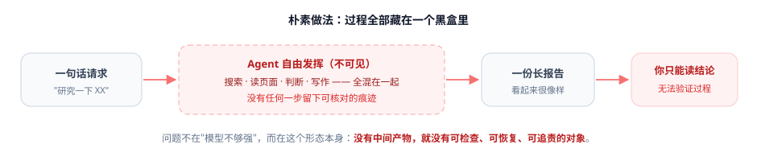
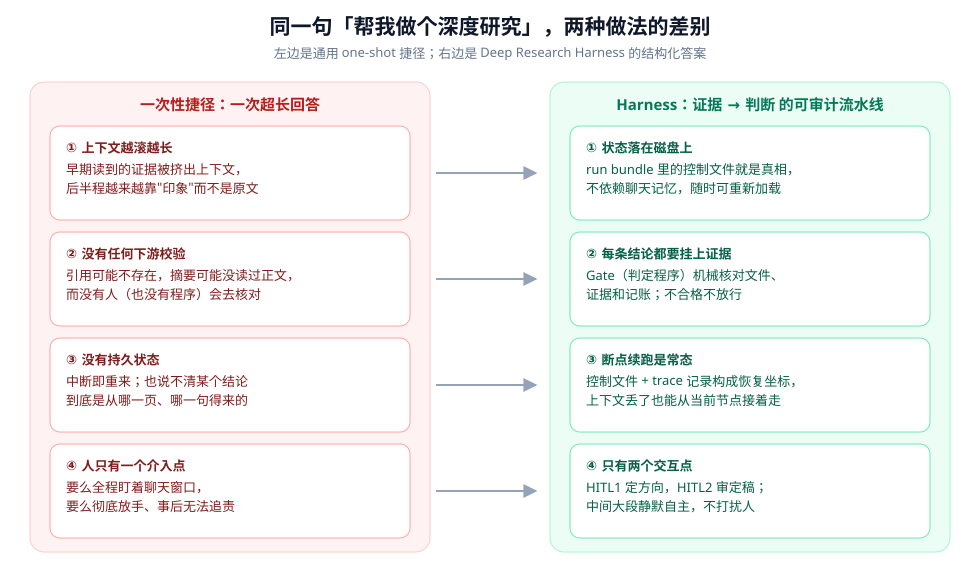
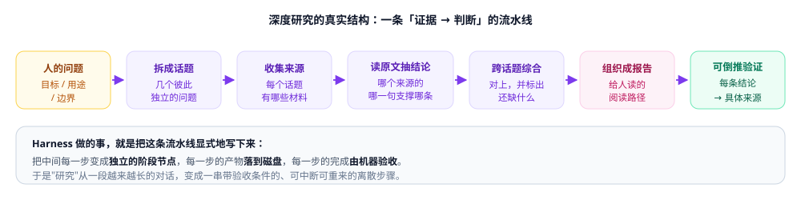
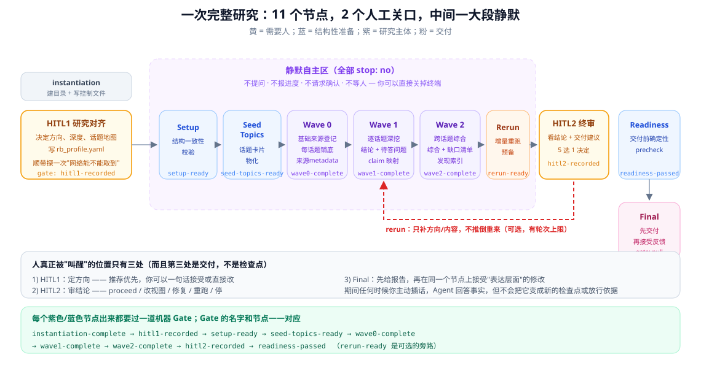
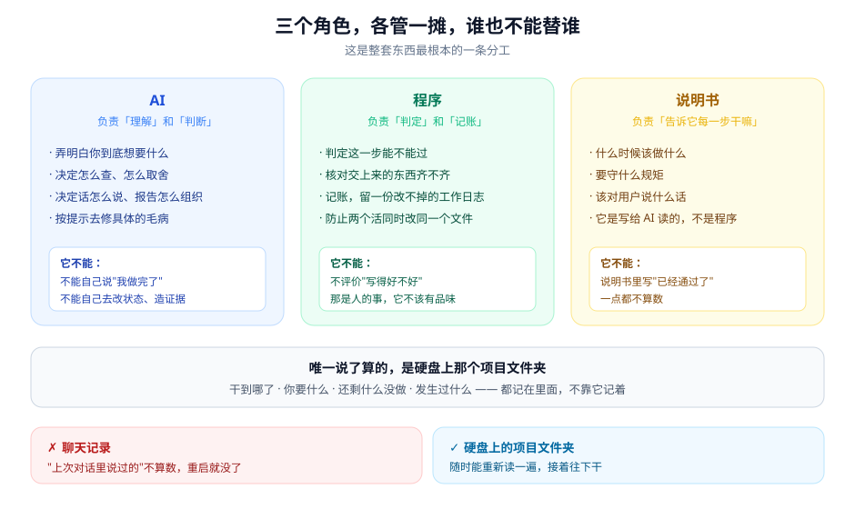

# 01 · 它是干什么的

> 这一篇只讲道理，不碰技术细节。正文里不出现代码名、字段名、命令。
>
> 读完能回答两个问题：**这东西是干什么的？用它是什么感觉？**

---

## 一句话

**你给它一个研究题目。它自己花几个小时到几天，把资料查完、读完、核完，中间不打扰你。最后交给你一份报告——报告里每条关键结论后面，都挂着一个能点开的原始出处。**

就这样。没有别的。

---

## 用起来是什么样

前后五步，一口气说完。

**第一步：你把题目发过去。**

就像平时那样，一句话也行：

> 帮我看看，现在做企业 AI 落地的，到底是真在做还是就喊喊口号。

**第二步：它回来找你一次。**

不是来问你要什么格式，而是给你一份**方案**——研究什么、范围到哪儿、报告必须回答哪几个问题、分几个话题、挖多深、大概要多久。

你看一眼，点头，或者改其中哪一条。

**第三步：然后它消失。**

真的消失。不给你发进度、不报错、不发半成品。几小时到几天，看题目多大。

**第四步：它带着报告回来。**

**第五步：你看，然后开口。**

这时候才轮到你费脑子：判断这些结论你信不信、够不够硬。有意见就提，它改。

---

**中间那一段，没有任何需要你操心的事。**

这就是它跟"直接用 AI 查"最直观的区别。

---

## 它一般要跑多久

不好一概而论。给个参照：仓库里那个真实跑完的项目，22 个话题，前后跨了大约 **5 天半**。

不过要说明——那 5 天半里大部分时间是**空着的**。因为状态都放在硬盘上，中途没人管也不会坏。

---

## 那它跟直接让 AI 查，到底差在哪？

差在**你看不见的那一段**。

平时用 AI 查东西，中间那一段是个黑盒：它默默搜、默默读、默默写，最后交给你一份东西。这份东西靠不靠得住，你没地方问。

你托一个朋友帮你查点事，其实是一样的处境。

"帮我看看，现在做企业 AI 落地的，到底是真在做还是就喊喊口号。"

三天后他回来了，给你一份东西：十几家公司的情况，有分析、有结论、还附了几个链接。

**而你现在要拿这份东西去做决策。** 于是你开始犯嘀咕：

- 他附的那些链接，是真看过，还是随手搜了几个标题？
- 他说"某公司客服人数回升"，这是从哪儿看来的？年报？还是某个博主的二手转述？
- 他有没有可能压根没查全，只是把最先搜到的三五篇拼了拼？
- 如果下周我想让他补一块，他还记得住三天前看了啥吗？

**你没法问。** 因为中间那三天是个黑盒，你只看到了最后的成品。

这就是"让 AI 做深度研究"的处境——而且比托朋友更糟，因为朋友至少会心虚，AI 不会。

### 黑盒的四个毛病

这四个毛病**跟聪明不聪明没关系**。换成世界上最聪明的模型，只要过程还是黑盒，它们就还在。

**毛病一：它会"忘"。**

AI 能同时"记着"的东西是有限的。你让它查十个话题，查到第八个的时候，第一个话题里读过的原文很可能已经被挤出去了。它还在聊那个话题，但已经是**凭印象**在聊。

这不是它偷懒，是它的工作机制。

**毛病二：没人核对。**

它写"根据某研究所 2025 年的报告"——

那个报告存在吗？它读过吗？还是它觉得"这种话听着挺合理的"就写了？

普通用法里，**没有任何环节会去核对这件事**。它写出来的和你读到的之间，没有任何检查。

**毛病三：断了就得重来。**

你聊了四个小时，电脑崩了，或者窗口开太多把页面刷了。

全没了。

而且就算没崩，你也说不清：第三条结论到底是从哪个网页的哪句话来的？

**毛病四：你要么全程盯着，要么完全撒手。**

没有中间状态。要么你一直守在屏幕前看它一步一步走（那你图啥），要么你交代完就走，回来收一份不知道掺了多少水的东西。

---

## 换个思路

上面四个毛病，本质上是同一件事造成的：

> **整个过程没有留下任何"中间产物"。**

没有中间产物，就没法检查（毛病二）、没法接着干（毛病三）、没法让你放心走开（毛病四）。而"忘"（毛病一）恰恰是因为**所有东西都只能装在它脑子里**。

所以解法不是"换个更强的模型"，而是：

> **把这件事从头到尾，当成一个真正的项目来做。**

有工序、有中间交付物、有验收、有工作日志。

打个比方：

- **原来**：你托了个朋友，他消失三天，回来给你个结论。
- **现在**：你雇了个项目经理，带一个团队干活。他每做完一步都要过一道验收，每笔开销都留发票，中间不烦你，最后交报告时**每条结论后面都贴着出处**。

这套东西要当的，就是那个项目经理。

---

## 三个基本约定

整套东西看起来很吓人：十几个阶段、几百个文件、上百条规则。

但地基就三条。看懂这三条，剩下的都是它们的自然推论。

### 约定一：东西记在硬盘上，不靠记性

还是用打游戏打比方。

- **没存档**：打到第八关死了，从第一关重来。
- **有存档**：死了读档，接着打。

AI 的记性是不能存档的那种。所以这里的做法很土，但很有效：

**每做完一步，把关键信息写进硬盘上的一个文件夹。**

下次要接着干，重新读这个文件夹就行。它自己记不记得，不重要。

这条看起来朴素，但它是后面**所有**能力的地基——可靠、能跑好几天、断了能续，全都建立在"东西在硬盘上"这一点上。

### 约定二：每一步都要过一道机器检查

这条最反直觉，也最关键。

平时我们用 AI，是**它说"做完了"，我们就信了**。这里把这个权力拿走了：

**每个阶段结束时，不是"AI 说完成"，而是跑一个检查程序，程序说通过才算过。**

打个比方：这不是"作业写完自己打个勾"，而是"作业写完交给老师批"。而这个老师，是个只会照清单核对的机器。

它只干几件事：东西在不在、格式对不对、数量够不够、有没有记账。

它**不评价**你写得好不好、分析得深不深、论证严不严密。

这一点非常重要，值得单独说：

> **机器管"交齐没有"，人管"写得好不好"。**
>
> 这两件事被刻意分开了。
> 机器不该有品味，人也别把时间浪费在数文件上。

还有一个细节很能说明态度：检查不通过时，程序会给一份明确的"下一步"——缺什么、该找谁修、修完重跑哪条命令。而不是甩一句"失败了"让你自己琢磨。

### 约定三：整个过程只找你两次

一次是**开工前**，一次是**交付前**。中间全静默。

**开工前那次**，就是前面说的"第二步"：它先自己想清楚，给你一份方案，你点头或者改。

你的角色是**审阅**，不是**填空**。审阅比填空省事得多——你只需要说"第三条不对，改成……"。

**交付前那次**，它把结论摆给你看，然后问：就这么交？还是换个角度？还是再补一轮？

**中间那一段**——从准备、拆分话题、查资料、深挖、跨话题综合——它不会来烦你。不问"要不要继续"，不汇报进度，不发半成品。你可以直接把窗口关了。

> ⚠️ **一个容易误会的地方**：最后报告交出来，**不算"第三次找你"**。
> 它的规矩是**先把报告拿出来**，再听你说"这段改改"。
> 而不是先问你"你想要什么格式"。因为"先给东西再改"比"先问再给"快得多，也少一轮来回。

---

## 谁说了算

这套东西里有三个角色，各管一摊，**谁也不能替谁**：

| 角色 | 管什么 | 不能干什么 |
|---|---|---|
| **AI** | 理解你要什么、决定怎么查、怎么表述、怎么修毛病 | 不能自己宣布通过、不能改记录、不能造证据 |
| **程序** | 判定这一步能不能过、记账、留工作日志 | 不能评价"写得好不好" |
| **说明书** | 告诉 AI 每个阶段该干嘛 | **写了"已通过"也完全不算数** |

最后一条特别值得记：说明书里写"这个阶段已经完成了"，一点都不算数。只有检查程序跑出来的结果才算。

这条规矩背后的想法是：**供判断的、供裁决的、供说明的，是三样不同的东西，混在一起就会互相污染。**

---

## 那我在中间插嘴会怎样？

这是个很实际的问题：我中途想起来一件事，能问吗？

**能问。它会直接回答你。**

但有个规矩：**这次回答不算数。**

意思是——你中途问的那句话，不会变成一个新的检查点、不会改变流程走向、不会产生什么"记住的中途意图"。回答完，它该干嘛还干嘛。

这个设计有点冷淡，但很有道理：**如果随便一句话就能改变流程，那"不用你管"就不成立了。** 想真正改方向，得走正式的路（开工前、交付前，或者明确要求重跑）。

---

## 这套东西的代价

说了这么多好处，也得说说不好的地方。它不是免费的：

**第一，文件多、概念多。** 一个新的 AI 要上手，得读不少东西。

**第二，有些步骤看着啰嗦。** 比如"读下一页说明书"和"记录上一关过了"是分开的两件事。看着多余，但这是为了让系统能分清"我真读了下一页"和"上一关其实没过"。

**第三，前期投入大。** 你得先把"一次研究分几步、每步什么算合格"想清楚。这本身就是件需要认真做的事。

### 什么时候别用它

这套东西适合：**结论要拿去做决策、需要交代来源、过程可能跨天。**

如果你只是想"查一下这个 API 怎么用"——别用，杀鸡用牛刀。

判断标准很简单：

> **这个结论如果你搞错了，会不会有麻烦？**
>
> 会 → 值得上这套。不会 → 随便问问就行。

---

## 一个真实项目的数字

| | |
|---|---|
| 文件数 / 体积 | 9,017 个 / 472 MB |
| 收集到的来源 | 693 条 |
| 派出去的活 | 116 个 |
| 干活过程中出的岔子 | 超时 16 次，失败 3 次 |
| 留下的操作记录 | 1,729 条 |
| 报告版本 | 5 版（当前版含 22 张证据卡） |
| 前后跨度 | 约 5 天半（中间有大量空着的时间） |

**注意那个"超时 16 次、失败 3 次"。** 这是一次**成功**的项目。

区别不在于"没出过错"，而在于：**每一次出错都有明确的下一步，而且全都留了记录。**

---

到这里，"它是干什么的"和"为什么这么设计"就讲完了。

**接下来有两条路：**

- 想知道**用起来具体是什么感觉、背后有些什么** → 去 [`user/`](./user/README.md)
- 想看**技术上是怎么做出来的** → 去 [`tech/`](./tech/README.md)

不确定走哪条？回 [目录页](./README.md) 看一眼三层结构。
