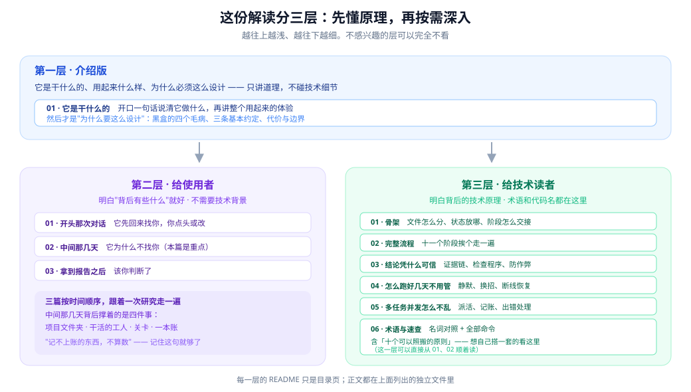

# Deep Research Harness 通俗解读

> **你给它一个研究题目。它自己花几个小时到几天，把资料查完、读完、核完，中间不打扰你。最后交给你一份报告——报告里每条关键结论后面，都挂着一个能点开的原始出处。**

这个目录里是一套**写给人的解读**，讲的就是上面这件事是怎么做到的。

分三层：**先懂原理，再按需深入。**

---

## 目录

### 第一层 · 介绍版

| 文件 | 讲什么 |
|---|---|
| [01 · 它是干什么的](./01-它是干什么的.md) | 它是干什么的、用起来是什么样、为什么必须这么设计、代价是什么。**只讲道理，不出现任何代码名和命令。** |

### 第二层 · [给使用者](./user/README.md)

明白"背后有些什么"就好，不需要技术背景。

| 文件 | 讲什么 |
|---|---|
| [01 · 开头那次对话](./user/01-开头那次对话.md) | 它为什么先回来找你、你要做什么、"接下来我消失一段时间"是什么意思 |
| [02 · 中间那几天](./user/02-中间那几天.md) | 它凭什么不来找你也能跑完、背后是哪四件事撑着、出岔子怎么办 |
| [03 · 拿到报告之后](./user/03-拿到报告之后.md) | 为什么它先给东西再听意见、该你判断什么、这份报告凭什么信 |

### 第三层 · [给技术读者](./tech/README.md)

术语、代码名、命令都在这一层。

| 文件 | 讲什么 |
|---|---|
| [01 · 骨架](./tech/01-骨架.md) | 文件怎么分、状态放在哪、说明书长什么样、阶段怎么交接 |
| [02 · 完整流程](./tech/02-流程.md) | 十一个阶段挨个走一遍，含两次人工关口的细节 |
| [03 · 结论凭什么可信](./tech/03-可靠性.md) | 三波分工、证据链、检查程序、防作弊 |
| [04 · 怎么跑好几天不用管](./tech/04-静默自主.md) | 静默契约、下一步怎么给、卡住了怎么办、断了怎么接 |
| [05 · 多任务并发怎么不乱](./tech/05-派工协议.md) | 派活、锁与事务、幂等、超时、恢复决策表 |
| [06 · 术语与速查](./tech/06-术语速查.md) | 名词对照、全部命令、可照搬的十个原则 |

---

## 怎么读

**只有十分钟** → 看完 [01 · 它是干什么的](./01-它是干什么的.md) 就够了。

**想先用起来** → 01 → [使用者三篇](./user/README.md)。到这里就够用了。

**想弄明白实现** → 01 → [技术层六篇](./tech/README.md)。建议从 01 和 02 顺着读。

**想自己搭一套** → 直接跳到 [tech/06 · 术语与速查](./tech/06-术语速查.md) 的**「十个可以照搬的原则」**，再回头补 01 和 05。

---

## 关于图的说明

所有插图在 [`img/`](./img/) 里，是手写的 SVG 文件，可以直接用浏览器打开看。

**图的语言跟着所在的层走**：介绍版和使用者层的图里不出现代码名；技术层的图里会出现，因为那里需要对得上代码。

---

> **最后说明一下这套文档的地位。**
>
> 它是一份**教学解读**，不是规范。真正说了算的，是 `DEEP_RESEARCH_HARNESS/` 里的代码和检查程序。这份文档跟代码冲突时，以代码为准。
>
> 要真的跑一次研究，看 `DEEP_RESEARCH_HARNESS/RUN.md`。
