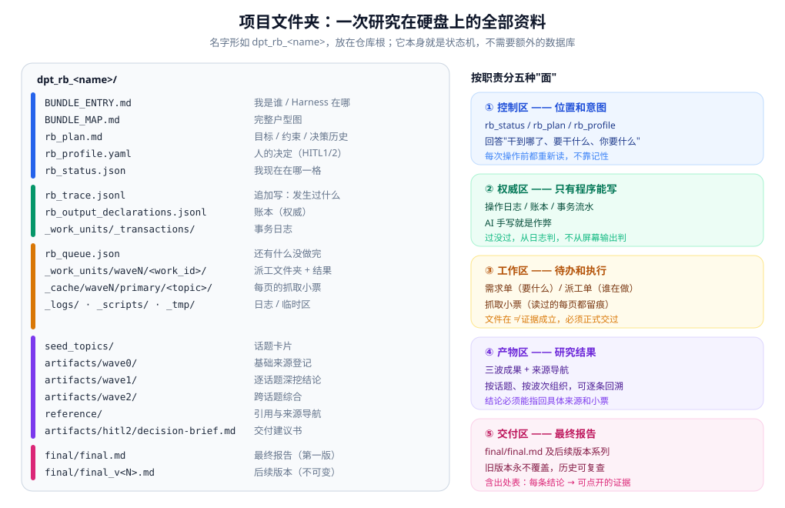
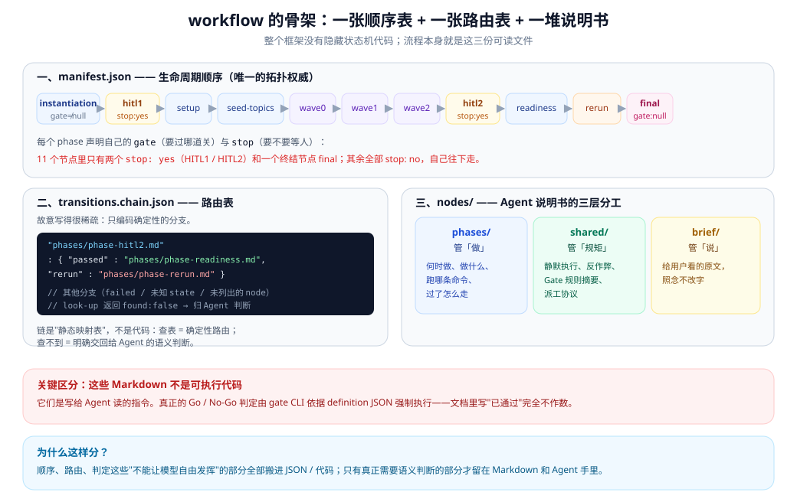
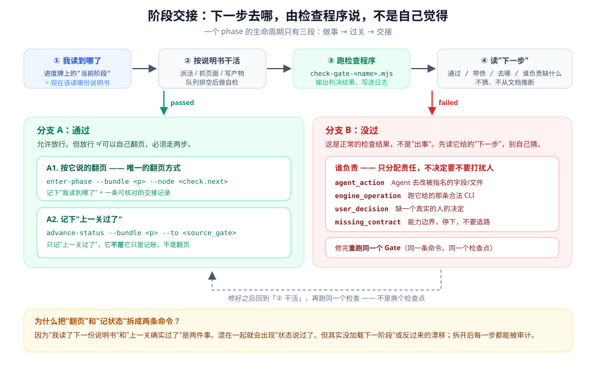

# 01 · 骨架：这套流程是怎么搭起来的

上一篇讲了"为什么要做"。这一篇讲"具体长什么样"。

不过先别急着看目录结构。这套系统里真正聪明的设计，是**把不同的东西放在不同的地方，而且规定只有特定的人能改**。

---

## 一、五类文件，五个抽屉

一个会自己跑很久的项目，最容易出的事故是**把不该混的东西混在一起**：

- "该怎么做"（指令）和"现在做到哪了"（进度）混在一起 → 重跑的时候不知道是照旧还是接着走
- "谁说了算"（权威）和"看起来像什么"（产物）混在一起 → 文件在那儿，就以为事情成了
- "临时草稿"和"最终交付"混在一起 → 分不清哪个版本是最终的

这套系统的做法很土：**物理上分开放，而且规定每一类只有特定角色能写。**



| 位置 | 装什么 | 谁能写 |
|---|---|---|
| **控制区** | 进度牌、需求单、施工方案 | AI 写内容，程序写位置 |
| **权威区** | 工作日志、账本、事务记录 | **只有程序** |
| **工作区** | 待办清单、派工单、抓取留痕、临时文件 | 程序派活，外包工写产出 |
| **产物区** | 话题卡片、三波的研究成果、来源导航 | AI 和外包工 |
| **交付区** | 最终报告 | **只能通过专用命令发布** |

**最重要的一列是"谁能写"。**

在这里，越权写文件不是"不规范"这种小事，而是被明确写进规则、定性为**作弊**的行为。

打个比方：这就像医院里清洁区和污染区分开，不是洁癖，是因为混了会出事。

---

## 二、别把"工具箱"和"工地"搞混

这是新手最容易栽的一个坑，所以单独讲。

这套系统里有三个"根目录"，它们完全不同，但都叫"根"，很容易混：

| 名字 | 是什么 | 打个比方 |
|---|---|---|
| 仓库根 | 你敲命令的地方 | 你家的地址 |
| 框架根（`DEEP_RESEARCH_HARNESS/`） | 工具本身，只读 | 你的**工具箱** |
| 项目根（`dpt_rb_xxx/`） | 本次研究的全部数据 | 本次的**工地** |

规矩是：**所有简写的路径，都是相对"工地"来说的。**

举个具体的：如果当前项目是 `dpt_rb_climate-policy/`，那么

```
_work_units/wave1/wu-w1-b000-deep-i0001/
```

指的是 `dpt_rb_climate-policy/_work_units/wave1/...`。

**不是**工具箱里的 `_work_units/...`，也不是仓库根目录下的 `_work_units/...`。

### 还有个容易混的：两种"只读"

工具箱（框架目录）有**两种**不同的"只读"，目的完全不一样，不能拿一个当另一个用：

| | 意思 |
|---|---|
| **干活期间只读** | 跑研究的时候，研究产生的文件不许倒着写回工具箱 |
| **改工具要走流程** | 想改工具箱本身，得走一遍正式的评审流程 |

第一条是"别把工地的土带进工具箱"；第二条是"想改工具，按规矩来"。

---

## 三、整个流程，就是三份能直接打开读的文件

这套系统最让人放心的一点：**它没有藏起来的状态机代码。**

流程本身，就是三份你能用记事本打开的文件：



### 1. 顺序表：一共分几步

`workflows/manifest.json` 里列着十一个阶段，按顺序排好，每个阶段标明"要过哪道关"。

改这张表的时候，必须同时改另外三个地方（这条规矩写在 `workflows/README.md` 里）。为什么？因为顺序一改，关卡的编号、验证程序、规则定义全得跟着动。**把"改了这里要记得改那里"写成明文规矩**，是这套系统的一个习惯。

### 2. 路由表：过关之后去哪

`workflows/transitions.chain.json` 是一张**故意写得很不全**的小表：

```json
{
  "phases/phase-hitl2.md": {
    "passed": "phases/phase-readiness.md",
    "rerun":  "phases/phase-rerun.md"
  }
}
```

只有**结果完全确定**的分支才写进去。

那没写进去的怎么办？查表查不到——**这不是漏写，是故意的。**

查得到 → 按表走，绝对确定。
查不到 → 说明这里确实需要判断，交回给 AI。

**这条规矩在整个系统里反复出现：能确定的交给代码，需要判断的留给 AI。**

### 3. 说明书：每个阶段该干嘛

`workflows/nodes/` 下面是给 AI 读的说明书，分三种：

| 目录 | 管什么 | 好比是 |
|---|---|---|
| `phases/` | **什么时候做什么** | 施工步骤 |
| `shared/` | **该守什么规矩** | 安全守则 |
| `brief/` | **该对用户说什么话** | 客服话术模板 |

第三种（`brief/`）单独拎出来，是有实际原因的：**给用户看的话必须是稳定的。**

如果每次都由 AI 现场组织语言，一方面体验会飘，另一方面它可能无意中承诺了系统没承诺的事（比如"我一定能帮你找到"）。所以这些话是**写好的模板，照着念，不改字**。

> **但注意：这三份都是给 AI 读的说明书，不是程序。**
> 说明书里写"已通过"，一点都不算数。真正的判定，只有检查程序跑出来的结果才算。

---

## 四、一个阶段的"身份证"

每个阶段文件的开头，都有一小段配置，相当于这个阶段的身份证。举个真实的例子（wave0 阶段）：

```yaml
gate: wave0-complete          # 这个阶段要过哪道关
stop: "no"                    # 要不要停下来等人 —— 这里是不用
search_policy: work_unit_required   # 查资料必须派工单，不能自己上手
delegated_role_keys:
  - dpt-source-intake         # 允许派哪几种外包工
requires:                     # 必须一起读的规矩（下面详细说）
  - shared/shared-silent-execution
  - shared/shared-anti-cheating-rules
  ...
```

几个字段用大白话解释：

| 字段 | 什么意思 |
|---|---|
| `gate` | 这个阶段的验收关卡。写 `null` 表示是最后一个阶段 |
| `stop` | **要不要等人**。`yes` 是"必须等用户回答"，`no` 是"自己干下去" |
| `search_policy` | **允不允许自己查资料**。有些阶段是纯分析，压根不许搜 |
| `delegated_role_keys` | 允许派哪几种外包工 |
| `requires` | **必须一起加载的规矩文档** |

最后这个 `requires` 挺聪明的：它是"按需加载"。

AI 不需要一上来读完整个框架。它进入某个阶段时，顺着这个列表，把这个阶段真正要守的规矩拉进来就行。这样每一轮对话要装的东西是可控的。

---

## 五、阶段交接：像接力赛

这是全篇最容易看错的地方，单独讲。

一个阶段走完要交接给下一个。**这个交接被刻意拆成了三步**，而且每一步的权限不一样：



用接力赛打比方：

| 步骤 | 干什么 | 好比是 |
|---|---|---|
| 1. 检查程序说"过关了，下一棒交给谁" | 判定 + 指路 | **裁判判定交棒有效** |
| 2. 一条命令真正打开下一份说明书 | 翻页 | **下一棒选手上场** |
| 3. 另一条命令记下"上一关确实过了" | 记账 | **记分牌更新** |

**为什么不合成一步？** 因为这是两件不同的事实：

- "我读了下一份说明书" —— 这是**位置**
- "上一关确实通过了" —— 这是**结果**

合成一步，早晚会出现两种情况之一：进度牌说过了、但其实没打开下一份说明书；或者打开了下一份、但其实上一关没过。

拆开之后，每一步都能被一个专门查错的工具单独核对。

> 顺带一提，这套系统里有个专门的诊断工具，就是干这个的：只报告哪里对不上，**不自动修**。因为自动修会把"为什么会对不上"这个线索抹掉。

---

## 六、什么交给代码，什么交给判断

这是判断一个自动化流程靠不靠谱，最实用的一个视角。

这套系统的答案是：**尽量把不确定的东西挤出代码之外。**

| 交给代码（确定的） | 交给 AI（要判断的） |
|---|---|
| 阶段顺序、过关之后去哪 | 用户到底想要什么 |
| 文件格式对不对 | 一个话题该怎么拆 |
| 数量够不够 | 这个来源值不值得信 |
| 有没有被改过（校验和） | 结论该怎么表述 |
| 记账、日志 | 报告怎么组织阅读顺序 |
| 状态前后是否自洽 | 哪个毛病该先修 |

还有一个更微妙的例子：**路由表里查不到的分支，明确归 AI。**

这不是"漏写了"，而是承认"这里确实需要判断，写死了反而错"。

---

## 七、几条看着奇怪的工程规矩

框架自己有几条硬规矩，看着奇怪，但都有理由：

- **只用 Node.js，不用 TypeScript，绝对不许用 Python。**
  理由：让任何人都能 clone 下来直接跑，不用配环境。

- **依赖库只有两个**（`zod` 和 `yaml`），其它全用语言自带的。
  理由同上。

- **测试必须放在仓库根的 `tests/`，不许放进框架目录。**
  理由：框架目录是要发给别人用的，里面不该混测试数据。

- **跑研究时写的临时脚本和草稿，必须放在项目文件夹里**（`_scripts/` 和 `_tmp/`），
  **不许写系统临时目录，也不许写仓库根。**
  理由很实际：放在项目里的东西会跟着项目一起归档，所以**事后还有人能看懂当时是怎么做的**。写系统临时目录，重启就没了，而且多个项目之间还会串味。

最后这条不是洁癖，是审计能力的一部分。

---

## 小结

这一篇的五个要点：

1. **五类文件分开放**，每类只有特定角色能写，越权写入等于作弊。
2. **三个"根"别搞混** —— 工具箱是工具箱，工地是工地。
3. **整个流程就是三份能打开读的文件**：顺序表、路由表、说明书。
4. **交接分三步**（判定指路 / 翻页 / 记状态），因为这是三件不同的事实。
5. **能确定的进代码，要判断的留给 AI。**

接下来看这套骨架动起来是什么样 👉 [02 · 完整流程](./02-流程.md)
