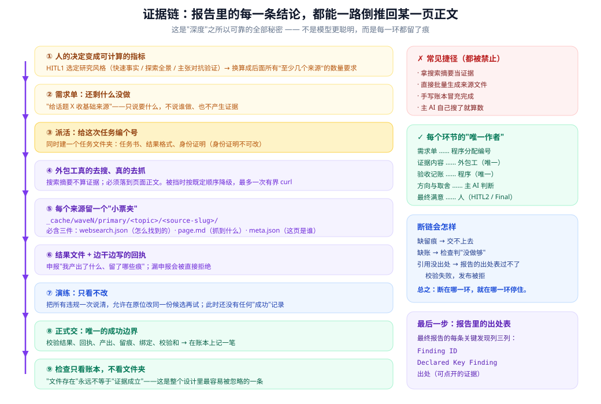
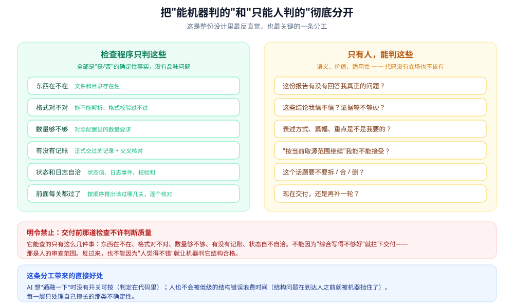

# 03 · 结论凭什么可信

这是整套系统里最实在的一篇。

核心想法，一句话：

> **不是指望它不出错，而是让每一个错，要么在某个地方被挡住，要么被如实记下来。**

下面四道保险，一层套一层。

---

## 第一道：分三步走，别想一次查到底


为什么不能"一次查到满意为止"？

因为一次查到底，会同时处理三件不同的事，而这三件事需要的东西不一样：

| 步骤 | 回答什么问题 | **明确不管什么** |
|---|---|---|
| **第一波：买菜** | 这个话题到底有没有材料？ | 不下结论、不辨真假、不做综合 |
| **第二波：洗切备料** | 这些材料到底说了什么？ | 不管跨话题的事 |
| **第三波：摆盘成席** | 放在一起看意味着什么？ | **不许偷偷加新料** |

最后一行值得展开。

**"第三波不许偷偷加新料"是什么意思？**

就是：综合的时候如果需要新证据，必须**重新走一遍采购流程**（派个专门的活去查，走完整的验收）。不能"边综合边顺手搜一下"。

这不是形式主义。它保证了**"综合结论"和"新增证据"在账上永远是两笔**。否则你事后根本分不清：这个跨话题的结论，到底是基于已有材料推出来的，还是它临时查了个新东西塞进去的？

### 还有一条规矩，专门防"假装深挖"

第二波有个很容易作弊的地方：把第一波已经收过的来源，换个说法再交一遍，假装自己"深挖"了。

它的挡法很硬：**用网址精确比对**。

```
第二波的"新来源" = 第二波接受的网址 − 第一波已有的网址
```

而且这个计算**由程序做，不采信 AI 自己在文件里写的声明**。

更细的一点：如果 AI 在文件里自己写了一份"其中 5 条是新来源"，程序会照自己的算法再算一遍，不一致就记一条警告——**以程序算的为准**。

### 第三波：缺口必须交代

第三波会得出若干条"发现"。每一条都带一个状态，说明"这条还缺不缺东西"。

如果某个发现被标成"还需要继续查"，那么必须二选一：

- 派个活去把它查了（并记进账本）
- **显式地**改成"记录在案""留给你决定"或"需要内部数据"

**不允许悄悄忘掉。**

而且"纯综合已完成"这个结论，只有在**没剩任何未解决的搜索缺口**时才成立——程序会数。

---

## 第二道：每条来源都要凑齐"四件套"



这部分你可以理解成**报销**。

你报销，光说"我花了钱"不行。得有**发票**、有**明细**、有**申报单**、有**审批记录**。少一样，财务就打回来。

这套系统里也一样。每读一个网页，必须留下四样东西：

| 要留的东西 | 说白了 | 存在哪 |
|---|---|---|
| **1. 小票文件夹** | 证明这一页真的被抓过 | `_cache/.../sNN_xxx/` |
| **2. 里面三个文件** | 怎么找到的 / 抓到了什么 / 这页是谁写的 | 同上 |
| **3. 一份申报单** | AI 主动申报"我产出了什么、留了哪些痕" | 结果文件里 |
| **4. 一笔账** | 程序验收后记下的那一笔 | 账本文件 |

**缺任何一样，提交的时候就交不上去。**

而且这不是靠自觉。提交的那一刻，程序会逐条核对：

- 那个小票文件夹必须**真的存在**，而且必须是**最底层的那个**（不能只写个上级目录糊弄）
- 里面三个文件必须有，而且"这页是谁"那个文件里必须能看出网址
- "抓到了什么"那个文件不能是空占位——**除非它明确写了"这次抓取失败"**
- 小票里的网址必须和申报单里的网址对得上（会做归一化再比）

### 一个真实的"这页是谁"

```json
{
  "url": "https://www.mitrade.com/...",
  "title": "Block's Controversial AI Layoffs Are Paying Off, Earnings Show - Mitrade",
  "source_domain": "www.mitrade.com",
  "fetched_at": "2026-09-08T18:35:29.973Z",
  "fetch_method": "node_fetch_tier3_bounded",
  "fetch_chain": ["native_web_fetch:blocked_dns_non_public_ip", "node_fetch_tier3:success"],
  "reliability_tier": "Tier 3",
  "reliability_basis": "financial news aggregator live-news earnings coverage",
  "outcome": "success"
}
```

注意那个 `fetch_chain`：**它记下了"第一次抓失败、第二次才成功"**。

这是这套设计里挺有人味的一点——**它不假装一切顺利，而是把过程里的降级如实留档。** 后面引用这条来源时，读者能看出来"这条是二级手段取到的"。

### 抓取有固定顺序，而且不许抄近路

规则里写死了对每个网址的取用顺序：

```
先用内置抓取 → 不行用浏览器 → 不行用程序直接请求 → 实在不行，最多试一次 curl
```

几条硬规矩：

- **不许把网址拼进系统命令**（防注入）
- **不许中途换个网址**（这个取不到就用同一个降级，不能偷偷换一个域名）
- **不许自己加新办法**
- **搜索结果的摘要不算"读到了页面"**

最后一条是全文最重要的一句：

> **"我在搜索结果里看到这句话" —— 这不构成证据。**
> 证据必须是页面正文。

---

## 第三道：检查程序

### 一次检查是怎么跑的

```
读规则清单 → 核对这是不是该检查的地方 → 逐条规则判定 → 汇总
  → 查路由表 → 写日志 → 输出结果
```

结果用退出码表示，三态，含义很明确：

| 码 | 意思 |
|---|---|
| 0 | 通过 |
| 1 | 没过（但可修） |
| 2 | 你命令敲错了 |

这个区分很实用：**1 是"活没干好"，2 是"你话没说对"。** AI 对这两种的处理完全不同。

### 没过的时候，它给你什么

不是甩一句"失败了"。它给三样东西：

| 给你什么 | 是什么 | 算不算"行动指令" |
|---|---|---|
| 法证细节 | 实际观察到了什么（预期 vs 实际） | **不算** |
| 建议 | 一般性的修法说明 | **不算** |
| **结构化下一步** | 谁负责、缺什么、改哪个文件、修完重跑哪条命令 | **算** |

**规则里反复强调：第一件事是读那个"结构化下一步"。**

前两样是给人看的散文，第三样才是给 AI 执行的指令。

### "谁负责"是分好的

那个结构化指令里有个字段，明确写着这件事该谁管，只有五种可能：

| 该谁管 | 意思 |
|---|---|
| AI 改 | 去改指定的那个文件/字段 |
| AI 跑命令 | 去跑它给的那条合法命令 |
| **问用户** | **缺一个真实的人的决定** |
| 环境问题 | 权限不够、网络不通，AI 代理不了 |
| 没有合法路径 | 停下，别硬来 |

这个字段的设计意图要特别说清楚：

> **它只回答"这件事该谁负责"，不回答"要不要去打扰用户"。**
>
> 要不要打扰用户，是另一个字段管的（还记得吗，每个阶段头上都标着"要不要等人"）。

这两件事分开，是很关键的。**否则一遇到问题，系统就会忍不住来问你。**

### 一个反直觉的地方：没过 ≠ 出错

路由表里**故意一条"失败分支"都没有**。

所以检查没过的时候，查表会查不到。**这不是 bug，是故意的。**

意思是：检查说"你没过"，但**不告诉你去哪**——往哪个方向修，要看那个"结构化下一步"的内容来判断。

这又是一次"确定的进代码，要判断的留给 AI"。

### "带着债放行"是什么

三个研究阶段的检查有个特殊机制。

如果同时满足这几个条件：

1. 确实有没过的地方
2. 就是在这个研究阶段
3. 同一个问题连续试了**三次**以上
4. 而且**所有**没过的地方，都是"数量不够"这一类（不是结构错、不是来源造假）

那么检查程序可以说：**行吧，带着这个缺口放行。**

**但会记一笔账。** 放行的时候会明确标注"这是带债通过"，把缺了什么写进日志，而且规矩里要求 AI 把它当成**欠着的债**，而不是"干净通过"。

几个限制让它不至于变成橡皮图章：

- **只要有一条"不是数量问题"的失败，整体就不许降级。** 结构错了、来源对不上，都不许打折。
- 目前整套模板里，允许这样放行的规则**只有 4 条**，全是数量下限。

说白了就是：

> **数量差一点可以商量，结构错了不行。**

---

## 机器管结构，人管好坏



这条边界在代码里是硬性的。

**验收那一步能检查的东西，只有这几种：**

文件在不在 · 目录空不空 · 配置能不能解析 · 日志格式对不对 · 该记的事件有没有 · 状态值对不对

**它不能因为"综合写得不够好"而拦下交付。**

反过来也一样：不能因为"人觉得不错"，就让机器判它结构合格。

举个具体的例子：验收会从顺序表里推出"应该过哪几关"，然后挨个去日志里核对——这是纯机械的。至于那些证据**够不够硬**，是在交付前审阅那一步由人判断的。

---

## 第四道：十六条"不许"

规则文件里列了 16 条明令禁止的行为。挑几条最能说明问题的：

| 不许干什么 | 为什么 | 拦得住吗 |
|---|---|---|
| 伪造日志、回执、检查结果 | 一旦能伪造，所有审计就归零了 | ✅ 程序拦 |
| 检查没过就改状态文件冒充过了 | 同上 | ✅ 程序拦 + 事后能查出来 |
| 把聊天记录当状态 | 重启就不作数了 | ⚠️ 纯靠自觉 |
| 凭记忆写最终报告 | 报告必须来自硬盘上的东西 | ✅ 程序逐条核对出处 |
| 验收时评价"写得好不好" | 机器不该有品味 | ✅ 设计上就锁死了 |
| 漏填"我产出了什么、留了哪些痕" | 漏了就断了证据链 | ✅ 提交时逐条拒绝 |
| 绕过"派工单"自己上手查 | 自己搜的没法计数、没法审计 | ✅ 四个检查项 |
| 伪造来源的"权威性" | 文件存在不等于证据成立 | ✅ 程序分类判定 |

### 关于"绕过派工单"

这条值得单独说。它禁止的事情很具体：

> **主 AI 不许自己直接搜索、自己抓网页，来冒充"这是外包工干的活"。**

也就是说，**"我自己搜了一下"不算数**。查资料的活必须走完整的派工流程：派单 → 外包工干 → 验收记账。

这样才能做到：能计数（花了多少工作量）、能审计（谁干的、留了什么痕）、能并发（多个活同时干）。

### 得坦白一句

这 16 条里，**有几条是纯靠自觉的**，机器挡不住：

| 规矩 | 强制方式 |
|---|---|
| 不许伪造日志 | ✅ 程序 |
| 不许把聊天记录当状态 | ⚠️ 纯自觉 |
| 不许编造"用户说过" | ⚠️ 能挡空白，挡不住谎报 |
| 不许提前声称"覆盖够了" | ⚠️ 纯自觉 |
| 出了错要按指示修，别自己发挥 | ⚠️ 纯自觉 |

**这个坦白本身也是设计的一部分。**

它没有假装"我全都验证了"，而是明确区分"我能证明的"和"我依赖你自律的"，并且把后者也写成明文规矩。这比含糊地说"请务必遵守"要诚实得多。

---

## 最后一道：报告里每条结论都要对得上账

报告交付的时候，程序会**逐行核对**。

每份主报告里必须有一张表，长这样：

| 发现编号 | 结论 | 出处 |
|---|---|---|
| W2F-021 | 某公司 2025 年客服人数回升 | （一个能点开的证据文件） |

程序会检查：

- 这张表存在，而且只有一张
- 每一行三格都填了，同一个编号的说法不自相矛盾
- 每一行的出处是**安全的、能解析的、真实存在的文件**
- 而且它必须是这三类之一：
  1. 正式验收通过的产出
  2. `reference/` 目录里、通过了权威性判定的文件
  3. **同一版本**的辅助文件

最后这条排除了几种常见的糊弄：

| 不能当出处 | 为什么 |
|---|---|
| 缓存文件 | 那只是抓取留痕，不是证据 |
| 索引目录 | 索引是导航，不是证据 |
| 综合台账 | 二手汇总，不是原始素材 |
| 别的报告 | 报告不能自己给自己作证 |

**只要有一个出处找不到真实的证据文件，发布就会被拒。**

也就是说：**报告里的每一句话，要么有出处，要么不能写。**

---

## 一个诚实的地方：失败是流程的一部分

回头看那个真实项目的日志：

```
超时          16 次
超时后重派     16 次
提交被拒        2 次   ← 一次缺回执、一次缺留痕
彻底失败        3 次
失败后派替补    3 次
```

**一次成功的项目，里面也有 16 次超时、3 次失败、3 次重派。**

这说明这套系统是**带着失败在跑**的，而不是"没有失败"。

区别在于：

- 每次失败都有**确定的下一步**（见 [05](./05-派工协议.md) 那张处理表）
- 每次失败都**留了完整的记录**
- 失败不会污染成功路径——失败的活和验收通过的账，是分开记的

**这就是"可靠"在这里的真实含义：不是不出错，而是出错之后依然能收敛到一个能交代的结果。**

---

## 小结

四道保险叠在一起：

1. **分三步走** —— 每一步只管一件事，而且明确"不管什么"。
2. **证据四件套** —— 像报销，缺一张票就报不了。
3. **分层检查** —— 结构问题机器挡，好坏问题人判断；没过的时候给"下一步"。
4. **交付逐条核对** —— 每条结论都要能点开一个真实文件。

再加一条贯穿始终的态度：

> **降级要记、失败要记、缺口要标。** 不许悄悄抹平。

---

## 想动手看看

> 下表路径都相对框架目录 `DEEP_RESEARCH_HARNESS/`。

| 这段话在说什么 | 代码里在哪 |
|---|---|
| 16 条"不许" | `workflows/nodes/shared/shared-anti-cheating-rules.md` |
| 抓取的固定顺序 | `workflows/nodes/shared/shared-page-fetch-guidance.md` |
| 来源文件要写哪五个段落 | `workflows/nodes/shared/shared-reference-template.md` |
| 验收那一步的规则清单 | `schema/gate_definitions/gate-*.definition.json` |
| 允许"带债放行"的 4 条规则 | 上面那些 JSON 里搜 `degradation_eligible` |

---

接下来看它怎么能跑好几天不用管 👉 [04 · 怎么跑几天不用管](./04-静默自主.md)
