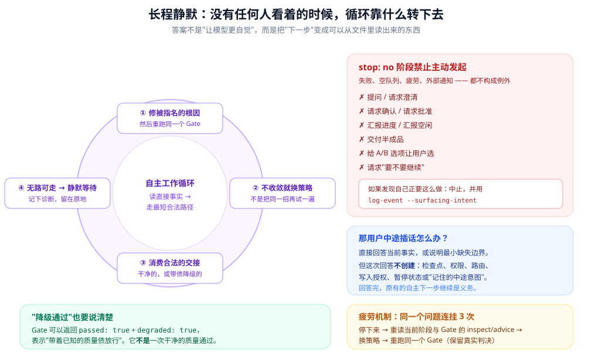
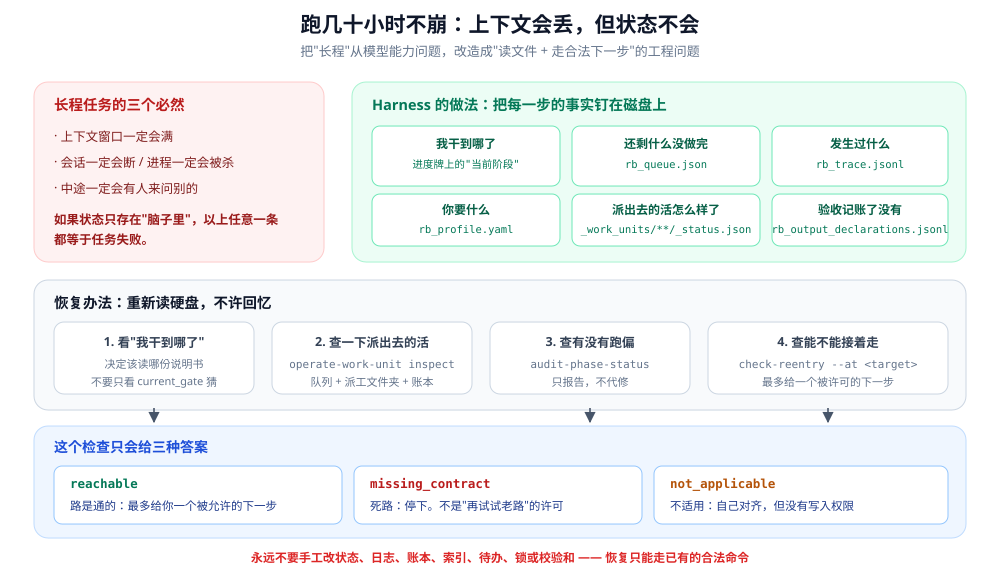

# 04 · 怎么跑好几天不用管

前面说"中间一大段是静默自主"。这一篇讲的就是：**凭什么它一个人待着不出事。**



---

## 先看看无人盯着的 AI 会怎么坏

对症才能下药。一个没人管的 AI 跑上八小时，典型有六种坏法：

| 坏法 | 具体表现 |
|---|---|
| **忘了** | 聊得太久，前面读过的原文被挤出去了，开始凭印象说话 |
| **死磕** | 卡在一个坎儿上，换个说法再试一遍、再试一遍、再试一遍 |
| **跑偏** | 中途开始做没人让它做的事——擅自扩大范围、加没要求的东西 |
| **过早收工** | 觉得"差不多了"，就宣布完成 |
| **无声死亡** | 进程被杀、窗口爆了，没有任何"我干到哪了"的坐标 |
| **来烦你** | 一遇到问题就发消息问"要不要继续啊" |

下面每一条机制，都对应治其中一种。

---

## 要点一：该不该找你，是写死的

每个阶段文件的开头，都有一行：

```yaml
stop: "no"     # 自己干下去
stop: "yes"    # 停下来等人
```

整个流程十一个阶段，标 `yes` 的**只有三个**：对需求、交付前审阅、以及最后的交付。

其余全部是 `no`。

**`no` 的含义写得很具体**——不是"尽量别打扰用户"这种软话，而是**明令列举了不许做的事**：

- ✗ 提问 / 请求澄清
- ✗ 请求确认 / 请求批准
- ✗ 汇报进度 / 汇报空闲
- ✗ 交付半成品
- ✗ 给 A/B 选项让你选
- ✗ 问"要不要继续"

而且明文写着：**检查没过、本轮干完了、待办清单空了、干累了、外面来了个通知——都不是例外。**

这就治好"来烦你"和"过早收工"。

### 一个挺聪明的自省机制

规则里还留了个自我监控的口子：

> 如果你发现自己**正要**去打扰用户，中止，并记一条日志说明"我差点想干什么、为什么"。

这条日志的性质是**诊断，不是许可**。它的用处是：事后你能看出"AI 最容易在哪些地方想来找人"，然后改进规则。

### 还堵了一个漏洞

规则专门写了一句话：

> 用户说中文，**不等于**用户想看中文进度汇报。

也就是说：**语言偏好不是打扰许可。**

---

## 要点二："下一步"是系统给的，不用它想

这是长程自主最核心的一条。

> **不要问 AI"接下来该干什么"，而是让系统直接告诉它。**

系统会在几个关键时刻给出"下一步"：

| 什么时候给 | 给什么 |
|---|---|
| 检查通过 | 该去哪个阶段 |
| 检查没过 | 缺什么、该找谁修、修完重跑哪条命令 |
| 每一步操作成功后 | 一句话重述"你现在该做的那一个动作" |

关于最后一种，规则里有个措辞很讲究：

> 这些提示**只是帮助，不是权威**。

意思是：它让 AI 更快，但**如果提示出错了，系统不会跟着错**。因为真正的依据永远是检查程序的输出和硬盘上的状态。

**为什么这条能治"忘了"？**

因为"下一步"不再依赖它记住。**上下文全丢光了也没关系**——重新读一遍硬盘上的状态和检查结果，下一步自己就浮现出来了。

---

## 要点三：卡住了，按四条顺序试

规则把"接下来怎么办"压缩成一个**有先后顺序**的四步：

```
1. 修被指名的那个具体毛病，然后重跑同一个检查
2. 如果修不好，换招 —— 而不是把同一招再试一遍
3. 接受一个合法的放行（干净的，或者带债的）
4. 如果确实没有合法路径了：记下诊断，安静地停在原地
```

**这四步的价值在于顺序是死的。** AI 不需要发挥创造力，从上往下试就行。

第四步尤其重要：**"走不通"是一个允许的状态，不是失败。** 它有个名字叫"静默等待"。

规则还专门写清楚它**不是**什么：

> 静默等待不是完成、不是跳过阶段、不是交付、也不是"获准去问用户"。

---

## 要点四：同一个坎儿摔三次，必须换招

**死磕**是长程 AI 最典型的毛病。

规矩是：**同一个问题连续三次没过，停下来换招。**

```
第三次没过 → 暂停当前修法
          → 重读这个阶段的说明 + 检查给的建议
          → 换一个思路
          → 重跑同一个检查（保留真实结果）
```

几个细节：

- **换的是办法，不是结论。** 不能把"没过"改成"过了"。
- **换招不等于可以问用户。** 静默契约不变。
- **次数取两个数里大的那个。**

最后这条挺有意思：AI 可以自己报"我试了 2 次"，但系统会从日志里数一遍，**两个数取大的**。

**也就是：自报不能少报。**

---

## 要点五：可以带着债走，但债要记账

三次之后，如果**只是数量差一点**（不是结构错、不是来源造假），系统允许"带着缺口放行"。

条件很严：

1. 确实有没过的地方
2. 就是在这个研究阶段
3. 同一个问题试了三次以上
4. **所有**没过的地方都是"数量不够"这一类

放行时会明确标注"这是带债通过"，把缺了什么写进日志，而且要求 AI 把它当成**欠着的债**，不是干净通过。

这条规矩的哲学是：

> **长程任务必须在"永远不放弃"和"永远不放过"之间，留一条出路。**

出路长这样：

- **结构错了，必须修好**（不许打折）
- **数量差一点，可以放行**（但要记账）
- **带债放行 ≠ 干净通过**

---

## 要点六：断了怎么接上

长程任务里，**上下文丢失是常态，不是异常。**



系统的做法很简单：**任何需要状态的时候，重新读硬盘，不许回忆。**

具体四个动作：

| 想知道什么 | 去哪看 |
|---|---|
| 我干到哪了 | 进度牌上的"当前阶段" |
| 还剩什么没干 | 待办清单 + 查一下在飞的活 |
| 有没有跑偏 | 跑一次专门的诊断工具（**只报告，不自动修**） |
| 能不能接着走 | 跑一次"重入检查" |

### 一条明确的禁令

规则反复强调：

> **不要只看"上一关过了没有"来判断该读哪份说明书。**

因为那是两个不同的东西：

- "上一关确实过了" —— 记的是**结果**
- "我读到哪份说明书了" —— 记的是**位置**

只看前者，就会出现"状态说过了、但其实没打开下一份说明书"这种事。**这正是那个诊断工具专门要抓的。**

### 重入检查只会给你三种答案

| 答案 | 意思 | 该怎么办 |
|---|---|---|
| 路是通的 | 最多给你**一个**被允许的下一步 | 照做 |
| 死路 | 明确没有合法路径 | **停下**，不许"再试试老路" |
| 不适用 | 得靠语义判断对齐，但**没有写入权限** | 自己对齐，别动手 |

---

## 要点七：你中途插嘴会怎样

这是实践中最常被问到的问题。规则的回答很精确：

> 用户主动发消息时，AI 直接回答当前事实，或说明最小的缺失边界。**但这次回答不创建**检查点、状态、权限、路由、写入授权、暂停状态，或"记住的中途意图"。

拆开说：

| 你插话会发生 | 不会发生 |
|---|---|
| 它回答你的事实问题 | 不会变成一个新的检查点 |
| 原有的自主工作继续是它的义务 | 不会改变"要不要等人" |
| | 不会改变它在哪个阶段 |
| | 不会改变"下一步该干什么" |
| | 不会产生"记住你中途说的那件事" |

还有一条补充：**不许声称你说的事情已经被采纳了**，除非确实有一个正式的路径把它记下来了。

**对你的实际价值**：你可以随时问，但不会无意中把流程带偏。想真正改方向，得走正式的路。

---

## 要点八：什么时候算干完了？看清单，不看感觉

一个自主循环必须有停止条件。否则它要么无休止地找活干，要么过早宣布完成。

这套系统的停止条件**由程序算**，不靠感觉：

```
如果待办清单和"在飞的活"都是空的
    → 队列状态：已排空，可以停
否则
    → 队列状态：必须继续
```

**这条治的是"过早收工"**：能不能停，是清单说了算，AI 不能自己觉得"差不多了"。

同样的思路也用在检查上：**跑研究阶段的检查之前，必须确认待办清单和在飞的活都空了**——有一条专门的规则管这个。

> 有意思的是，这个"停止授权"的枚举里有四个值，但**只有两个会被程序写入**。另外两个是留着的位置，没有代码会写它们。

---

## 要点九：派了活要主动盯，不能干等

长程任务里最常见的"假等待"是：AI 派了个活出去，然后开始等通知。

规则明确禁止：

> 必须**主动轮询**。**通知只是提示。**

也就是说，AI 要主动去查硬盘：队列状态、每个活的进度文件、结果文件、留痕文件。

然后：**不用等用户，也不用等通知**，活干完了就验收。

还有一条重要禁令：

> **只要有派出去还没收回来的活，就不许跑这个阶段的检查。**

---

## 要点十：跑偏是能查出来的

长程任务最隐蔽的杀手是**慢慢跑偏**——每一步看着都合理，累积起来已经偏了。

系统有一个专门的诊断工具。它会输出十一种结论之一，比如：

| 结论 | 意思 |
|---|---|
| 一致 | 没问题 |
| 状态对不上 | 进度牌和日志说的不一致 |
| 疑似手工跳过 | 像是有人绕过了流程 |
| 缺证据 | 说这一关过了，但找不到对应的记录 |
| 检查没过但状态已推进 | 典型的"抢跑" |
| 出现了不该有的成品 | 比如还没到交付阶段，报告文件就出现了 |
| 进度记录被动过 | 施工方案上打了个勾，但找不到对应的记录 |
| （还有一个）被声明的启动例外 | 这是正常的，不是问题 |

**关键点：它只报告，不自动修。**

> 诊断说"这里对不上"，但**不会去改**。因为自动修会把"为什么会对不上"这个线索抹掉。

而且有个很实在的例子：真实项目里**真的出过一次误操作**（在已经交付完之后，又跑了不该跑的检查），而且**这个误操作被写成了一份事故记录**存在项目文件夹里。

连"框架被误用"这件事本身都被留档了。

---

## 反面清单：六种坏法对照

把上面的机制倒过来看，就是一份很实用的对照表：

| AI 常见的坏法 | 一般做法（不靠谱） | 这套系统的做法 |
|---|---|---|
| 忘了 | 靠上下文记着 | 状态在硬盘上，随时重读 |
| 死磕 | 无限重试同一招 | 三次必须换招 |
| 跑偏 | 靠 prompt 提醒"别做多余的事" | 每个阶段明确列出允许的动作 |
| 过早收工 | 靠它自己判断"差不多了" | 待办清单空了才算 |
| 无声死亡 | 没有恢复坐标 | 进度牌 + 日志 + 重入检查 |
| 来烦你 | prompt 里说"尽量自主" | "要不要等人"是写死的字段 |

---

## 小结

十个技术要点：

1. **该不该找你，是写死的字段**，不是态度
2. **下一步是系统给的**，不用它想
3. **卡住了按四条顺序试**，顺序是死的
4. **三次必换招**，而且次数取"自报"和"系统数的"里大的那个
5. **数量可以带债，结构不行**，债要记账
6. **断了就重读硬盘**，"读到哪了"比"过没过"更该看
7. **你插嘴它会答，但不算数**
8. **干完没有，看清单不看感觉**
9. **派了活要主动盯**，通知只是提示
10. **跑偏能查出来**，而且只报告不自动修

一句话总结：

> **静默不是"不说话"，而是把每一次"需要说话"的时刻，都换成了一个它自己能完成的确定动作。**

---

## 想动手看看

> 下表路径都相对框架目录 `DEEP_RESEARCH_HARNESS/`。

| 这段话在说什么 | 代码里在哪 |
|---|---|
| 静默期不许干的事 | `workflows/nodes/shared/shared-silent-execution.md` |
| "要不要等人"的字段 | 各阶段文件开头的 `stop:` |
| 停止条件怎么算的 | `engine/queue-manager-core.mjs` 里的 `syncQueueHealth` |
| 那个诊断工具 | `cli/audit-phase-status.mjs` |
| 重入检查 | `cli/check-reentry.mjs` |
| 三次换招的阈值 | `engine/helpers/gate-degradation-policy.mjs` |

---

接下来看多个任务同时干怎么不乱 👉 [05 · 多任务并发怎么不乱](./05-派工协议.md)
