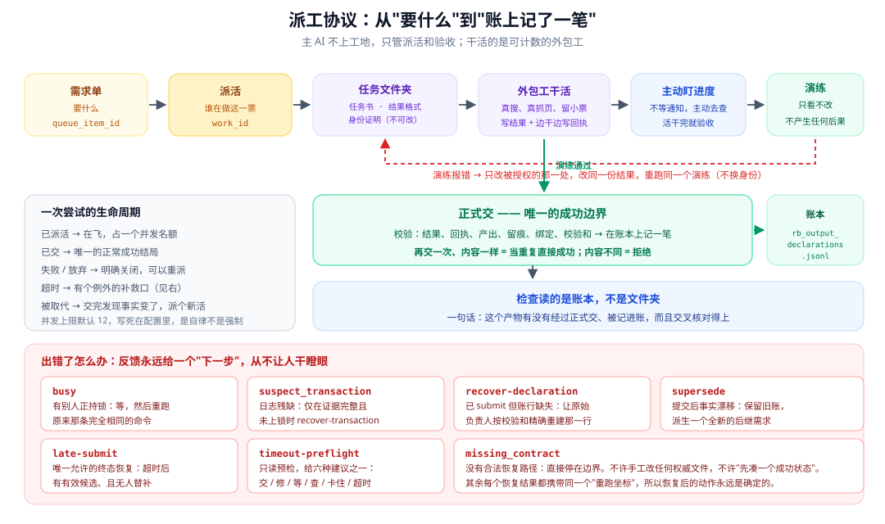
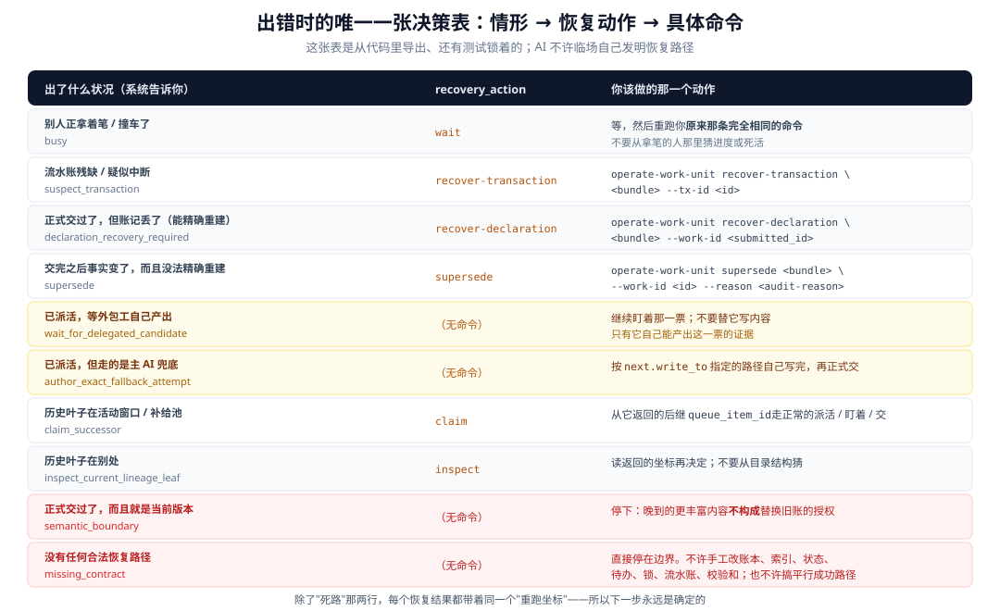

# 05 · 多任务并发怎么不乱

这一篇讲最难也最值钱的部分：**当很多活同时干、而且随时可能出岔子的时候，怎么保证账目不错。**



---

## 先说一个前提：主 AI 不上工地

这套协议之所以存在，是因为一个刻意的分工：

| 角色 | 干什么 |
|---|---|
| **主 AI**（项目经理） | 派活、验收、修毛病、过检查 |
| **外包工**（小助手） | 真去搜、真去抓、真去读、真去核 |

规则里有条很硬的禁令：

> 主 AI 不许自己直接搜索、自己抓网页，来冒充"这是外包工干的活"。

**为什么？** 因为一旦主 AI 可以自己上手，会同时坏三件事：

1. **没法计数** —— 你不知道到底干了多少活、花了多少成本
2. **没法审计** —— 这段搜索没有派工单、没有回执、没有账
3. **没法并发** —— 主 AI 是单线程的，它自己搜就得一件一件来

所以"要研究"这件事，必须被翻译成**可以派出去的活**。

---

## 第一层：待办清单

待办清单回答一个问题：**还剩什么没做。**

它分四个区：

| 区域 | 装什么 | 上限 |
|---|---|---|
| **活动区** | 前面正在处理的 | **20 条**（硬上限，程序强制） |
| **补充池** | 排队的，前面有空位就补上 | 无 |
| **在飞** | 已经派出去、还没收回来的 | 看并发上限 |
| **档案** | 已经结束的 | 无 |

### 优先级有七档

从"被抢占的任务要恢复"（最急）一路排到"梳理结构"（最不急）。排序规则是死的：先看要不要恢复，再看优先级，最后看谁先创建。

### 一条刻意的约束

**待办清单里不许写"这个活是谁在干"。**

程序会直接报错：

> 需求单的身份是"要什么"，`work_id` 是留给系统分配的"这一次谁在做"的。

这条规矩的用意是**把"要什么"和"谁在做"彻底分开**：

- **需求编号** = 要什么（一件事只有一个）
- **派工编号** = 这一次谁在做（一件事可以派很多次）

同一个需求可以派很多次（超时重派、失败重做），但需求本身只有一个。

### 派活之前先做检查

派单不是随便写的。系统会核对：

- 这个活的类型是不是允许的三种之一
- 是不是绑在当前有效的话题上
- **同一个目标会不会有两个活同时写**

最后这条会产生一个明确的冲突提示，告诉你"谁已经占了这个目标"。

**这防止了两件事**：两个外包工同时写同一个文件、以及由此产生的覆盖丢失。

---

## 第二层：派工单

"派活"这个动作是整套协议里最关键的一步。它做两件事：

1. **分配一个派工编号**（只有程序能分配）
2. **生成一个装着八样东西的文件夹**

### 文件夹里的八样东西

```
_work_units/waveN/wu-w1-b000-deep-i0001/
├── manifest.json          系统写的绑定信息
├── task.md                任务书（外包工要读的）
├── result.schema.json     结果该长什么样
├── _beacon.json           身份证明（不可改）
├── runtime-receipt.jsonl  外包工边干边写的回执
├── result.json            外包工写的结果
├── _status.json           状态投影
└── _agent.json            可选的诊断信息（永远不算数）
```

其中"身份证明"是关键。它绑定了几样东西：

- 派工编号、需求编号、活的类型
- **项目文件夹的绝对路径**（验收时必须完全一致）
- 一个一次性的随机串（防伪造）
- 截止时间
- 契约版本、该产出哪些文件、留痕要求

**它不可修改。** 改了就是身份冲突，得回到系统检查点。

### 派活时会返回一份"现成的开工提示"

派活成功后，每个活都会附带一份可以直接用的提示词，包含**绝对路径**和一段话：

> 打开任务书，从"完成契约"那一节开始干：`<绝对路径>`

以及一句很重要的边界说明：

> 这个绑定是**逻辑上的约定，不是对执行者的身份验证，也不能证明它真的活着**。

**这句话是整套设计里最诚实的一句。** 它明确承认：系统没法验证真的是一个独立的助手在做这件事。

### 身份坐标一览

| 名字 | 是什么 | 谁分配 | 长得像 |
|---|---|---|---|
| 需求编号 | 要什么 | 待办清单 | `wave1-deepen-01_xxx` |
| **派工编号** | 这一次谁在做 | **只有程序** | `wu-w1-b000-deep-i0001` |
| 尝试序号 | 同一需求的第几次 | 程序 | `1`、`2`、`3` |
| 事务号 | 一次完整操作 | 程序 | `tx-1712345678-a1b2c3d4` |
| 一次性凭据 | 防伪造 | 派活时生成 | 一长串随机 |

派工编号的格式是有结构的：

```
wu-w1-b000-deep-i0001
│  │  │    │    └─ 第几次派活
│  │  │    └────── 活类型（deep = 深挖）
│  │  └─────────── 批次
│  └────────────── 第几波
└───────────────── work unit
```

**注意"尝试序号"不在里面。** 超时重派会生成**新的派工编号**，但需求编号不变，尝试序号加一。

所以：**一个需求 → 多次尝试 → 每次尝试有自己的编号。**

### 并发上限：12 是个"自律"，不是"强制"

配置文件里有个并发上限，默认 **12**。公式是：

```
这次派几个 = min(能并行干的活数, 并发上限, 还剩多少空位)
```

**但有个必须说清楚的细节**：这个字段**只在说明书里被提到，没有任何程序代码会读它**。

这意味着：

- 程序**不会阻止**你一次派 50 个
- "12" 是 AI 遵循协议时的自律上限
- 而"主 AI 自己兜底"这种模式下，**不管上限是多少，一次只派一个**

这是个很好的例子：**系统明确区分了"程序强制的"和"契约自律的"**——而且文档里写清楚了哪条是哪条。

### 派活之前要先"试一下人"

派活的时候，必须先提交一次**真实的探测结果**：

| 试的结果 | 打算用谁 | 判定 |
|---|---|---|
| 外包工可用 | 外包工 | ✅ 允许 |
| 外包工可用 | 主 AI 兜底 | ❌ 无效（能用外包工就别兜底） |
| 外包工不可用 | 外包工 | ⛔ 不派 |
| 外包工不可用 | 主 AI 兜底 | ✅ 允许（如果类型允许） |
| 不知道 | 随便 | ⛔ 不派 |

**这个设计解决了一个很实际的问题**：如果宿主环境根本不支持外包工，AI 不该在那儿空转，而应该明确降级（自己干），并且**在身份记录里如实写明"这次是我自己兜底"**。

---

## 第三层：一支笔 + 一本流水账

这是技术含量最高的部分。

### 一支笔：全局锁

整个项目只有**一把锁**，靠"创建一个文件夹"这个动作的原子性来实现：

- 创建成功 = 拿到锁
- 创建失败（已存在）= 锁被别人拿着

**所有**会修改派工记录的操作，都必须先拿到这把锁。

打个比方：**整个办公室只有一支笔，谁要用谁去拿。** 拿不到就在旁边等着。

### 进仓库前要登记，出门要查包

每次修改前，必须**先把要改哪些文件列清楚**。这是硬要求，不列就报错。

然后：

1. 程序给每个要改的文件**拍张照**（记下改之前的内容和校验和）
2. 让它改
3. 改完后，程序**扫描整个仓库**，算出实际变了哪些文件
4. **如果有"没登记却改了"的文件，整个操作直接失败**

```
transaction <事务号> mutated undeclared targets: <文件列表>
```

**这条规矩堵死了"顺手改了别的文件"这类事故。** 就像出门要查包，没登记的东西不许带走。

### 出错了要能原样还原

出问题时的回滚很扎实：

1. 按**倒序**把每个文件还原（原本不存在的删掉，存在的写回原内容）
2. 还原后**再核对一遍**，确认每个文件跟"照片"完全一致
3. 核对通过 → 记为"已回滚"
4. 核对不通过 → 记为"存疑"

那个"存疑"状态很重要：**它明确表示"我出事了，而且说不清有没有收拾干净"。** 这是给后面排查留的线索，不是含糊过去。

---

## 第四层：先演练，再正式交

验收分两步：

| | **演练**（dry-run） | **正式交** |
|---|---|---|
| 性质 | **只是预演，什么都不改** | 正式验收，记账 |
| 失败后果 | **没有任何后果** | 要回滚 |
| 作用 | 一次把所有问题说清 | 唯一的成功边界 |

分两步的好处很实际：**外包工可以在"不产生任何后果"的状态下反复试错。**

演练报错后，只改被授权的那一处，**改同一份结果**，再演练一次。不换身份、不换结果。

### 正式交的时候，会核对什么

全套机械核对：

| 核对什么 | 说白了 |
|---|---|
| 身份一致 | 几个文件里写的编号必须完全一样 |
| 快照校验和 | 派活时的待办内容，和现在的是不是同一份 |
| 契约版本 | 是不是当前版本 |
| 回执 | 每一行回执必须带着正确的编号和凭据 |
| 结果格式 | 格式不对直接拒收，**多写字段也不行** |
| 产出文件 | 声明了就必须真实存在 |
| 抓取留痕 | 必须是真实存在的**最底层文件夹**，三个文件齐全 |
| 来源申报 | 说"采信了"的，必须有留痕或明确记了失败 |
| 待办绑定 | 状态必须对得上 |

### 同一份交两次，一次成功一次拒绝

```
再交一次，内容校验和一样  → 当作重复，直接成功，不写新账
再交一次，内容校验和不同  → 拒绝：duplicate_content_mismatch
```

这条区分很重要：它让"网络抖动导致的重复提交"变成安全操作，同时堵住"偷偷换一份内容再交一次"。

### 交成功了会记一笔账

账本里追加**一行**，包含：谁干的、什么活、结果文件的校验和、声明了哪些产出、留了哪些痕……

**注意最后还有"这一行自己的校验和"。** 读账本的时候会重新验证一遍。

> **账本是只许往后加的，而且规则明确禁止 AI 手写它。**

### 交失败了也不是没声

失败会留下：

1. 在状态文件里记下**失败原因和错误码**
2. 写一条日志
3. 在返回里附上**"你现在该干什么"**

错误码是有限的几个，每个都能对上一个具体修法：缺回执、缺留痕、凭据对不上、编号不对、缺产出、快照过期、内容重复……

---

## 第五层：超时和唯一一个"迟到还能收"的口子

### 超时不是一个简单的时间判断

系统有个"超时预检"，**只看不改**，给出六种建议之一：

| 建议 | 意思 |
|---|---|
| 直接交 | 结果已经好了 |
| 修一下 | 结果可修，修同一个活 |
| 再等等 | 还有进展 |
| 去看看 | 绑定或结果有问题 |
| 卡住了 | 有明确阻碍，交给该管的人 |
| 可以超时了 | 正式判超时 |

判定顺序是死的，一共十一条，从"编号对不对"一路查到"租约还新鲜吗"。

### "租约"这个概念很实用

超时不是从派活那一刻开始算固定时长，而是**从最后一次真实进展开始算**：

```
租约起点 = 最后一次被验证过的进展（没有就用派活时间）
有效超时 = 租约起点 + 允许的闲置时长
```

**这意味着一个还在稳定产出的外包工不会被误杀**——它会不断续租。

而且"进展"必须是**被验证过的**（比如结果能通过演练），不是随便改个文件就算。这样就堵住了"用空转刷时间戳"。

### "迟到还能收"是唯一被设计出来的补救口

如果一个活已经判超时了，但后来发现结果其实是好的，怎么办？

答案很克制：**只有一个口子，而且条件很严。**

必须同时满足：

1. 必须写清楚为什么要收
2. 状态必须**正好是**"超时"
3. 这个活**没有任何**账
4. 同一个需求**没有已经交上来的替补**
5. 这个需求**还没有终态记录**（不能有两个"结束位置"）
6. 待办里**最多一个**排队的重试，而且必须指向同一个活

收下来之后，会记一笔**带标记的账**（写明"这是迟到的"），并把那个重试的活标为"作废"。

**为什么只有"超时"有这个口子？**

因为另外几种终态的性质不一样：

| 终态 | 还能收吗 | 为什么 |
|---|---|---|
| **超时** | ✅ 能（条件很严） | 超时是**环境的错**，内容可能还是好的 |
| 失败 | ❌ 不能 | 失败是**确定的坏结果**，只能重新派 |
| 主动放弃 | ❌ 不能 | 都主动放弃了 |
| 已交 | ❌ 不能 | 已经成功了，只接受同样的内容重复交 |

---

## 第六层：出错处理表

这是全篇最实用的一张表。

**任何出错反馈，都返回同一种格式**，其中包含"你现在该干什么"。



这张表一共十来行（程序里是个固定的枚举，还有测试锁着），完整版长这样：

| 出了什么状况 | 该干什么 |
|---|---|
| 别人拿着笔 / 撞车了 | 等，然后**重跑原来那条完全相同的命令** |
| 流水账残缺 | 只有在证据完整时才能修复那一笔事务 |
| 账记丢了但能重建 | 让原始负责人按校验和精确重建那一行 |
| 交了之后事实漂移了 | 保留旧账，重新派一个新活 |
| 已派活，等外包工 | 继续盯，**不许替它写内容** |
| 已派活，走的是兜底 | 按指定的路径自己写完再交 |
| 老账的活还在活动区 | 从这个活重新走正常流程 |
| 老账的活不知道在哪 | 先查一下，别瞎猜 |
| 已交且就是当前版本 | **停**：光凭内容更丰富，不构成替换旧账的授权 |
| 没有合法路径 | **停**：不许手工改任何权威文件 |

### "永远不是死路"，但要正确理解

规则里有一句承诺：

> 恢复的结果**永远不是死路**——它总是带着同一个"重跑坐标"。

具体意思是：不管恢复是成功了、还是"早就处理过了"、还是被拒绝了，返回里都会带着同一个坐标。**修完就回到产生这个问题的原始检查点重跑。**

**但要理解清楚**：这句话保证的是"有一个确定的坐标"，**不是"一定能成功"**。

最后那行"没有合法路径"就是明确的例外——它意味着**从当前信息里推不出任何合法做法**。这时候正确的动作是停下，而不是想办法绕过去。

### "停下"的时候，哪些事不许做

明令列出的：

- 手工改账本 / 索引 / 状态 / 待办 / 锁 / 流水账
- 手工改结果校验和
- 重试一个已经被拒绝的前任
- 建一个"平行的成功路径"

**这条规矩拒绝了一种很常见的诱惑：出问题了，手工改改数据让它"看起来对了"。**

---

## 真实数据里，这些机制拦住了什么

回到那个真实项目：

| 出了什么事 | 次数 | 真实原因 |
|---|---|---|
| 干活超时 | 16 | 外包工中途死了，租约到期 |
| 超时后重派 | 16 | 重新派，标记为第 2 次尝试 |
| 抢占待办 | 16 | 配套动作，把重试插到队首 |
| 提交被拒 | 2 | 一次缺回执、一次缺留痕 |
| 彻底失败 | 3 | 干到一半死了，什么都没留 |
| 失败后派替补 | 3 | 自动重派 |

**两件事值得注意：**

1. **16 次超时全部走完了完整链路**：超时 → 抢占重试 → 重新派活 → 最终提交。**没有一次需要人介入。**
2. **"缺回执"和"缺留痕"被挡住了**——这正是"证据四件套"在起作用。如果没挡住，就会有两份**没有留痕的"证据"**进入研究报告。

---

## 哪些是程序强制的，哪些靠自觉

把这一篇的结论分个类，很有启发。

### ✅ 程序强制的

- 编号格式、各种校验和、字段两两一致
- 全局锁、改前登记、未登记改动检出、逐字节回滚
- 正式交只接受"已派活"状态
- 重复内容拒绝、同内容幂等
- 路径不许逃逸、不许是软链接
- 交完之后的持久性复检

### ⚠️ 靠自觉的

- **探测结果是不是真的**（返回里硬编码了"未验证执行者身份""未证明存活"）
- **外包工是不是真的被启动、保活、并发跑**（程序不启动任何东西）
- **内容是不是被绑定的那个执行者写的**（程序只核对回显的标记）
- **并发上限 12**（程序不读这个字段）
- **AI 会不会按那张处理表办事**（而不是自己发挥）
- **AI 会不会手工改权威文件**（程序能**事后查出**一部分，但没有文件监控，拦不住即时的手工修改）

**这份清单本身，是这套设计最诚实的部分。** 它没有假装"全都验证了"，而是明确告诉你哪些地方需要信任。

---

## 小结

派工协议可以概括成五句话：

1. **需求和尝试分开** —— 需求编号是"要什么"，派工编号是"这一次谁在做"。
2. **并发上限是自律不是强制** —— 默认 12，但程序不读它。
3. **要么全做要么全不做** —— 改前登记、改后查包、出错逐字节还原。
4. **验收是唯一的成功边界** —— 演练试错，正式交记账，账本是权威。
5. **出错永远有确定的下一步** —— 十来行的固定处理表，只有"没有合法路径"是停。

**一句话：这套协议的价值不在于它能阻止所有错误（它做不到），而在于它让每一个错误都变得"看得见、找得到负责人、有确定的下一步"。**

---

## 想动手看看

> 下表路径都相对框架目录 `DEEP_RESEARCH_HARNESS/`。

| 这段话在说什么 | 代码里在哪 |
|---|---|
| 待办清单的结构和上限 | `schema/contracts/queue.mjs` |
| 派活、验收、超时、恢复的命令 | `cli/operate-work-unit.mjs` |
| 那张出错处理表的定义 | `engine/work-unit-repair-vocabulary.mjs` |
| 出错处理表的完整版 | `DEEP_RESEARCH_HARNESS/RUN.md`（有一张对照表） |
| 事务和锁 | `engine/work-unit-transaction.mjs` |

---

最后是术语和速查 👉 [06 · 术语与速查](./06-术语速查.md)
